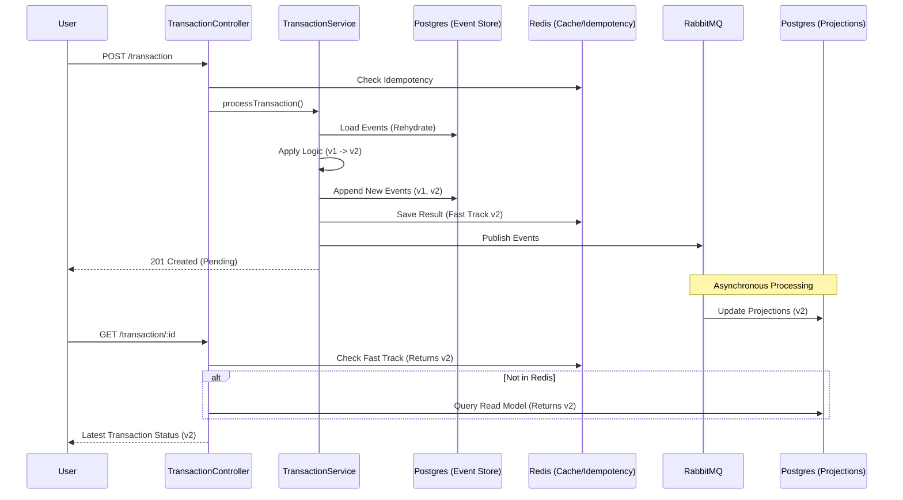

# Fast Logic - Event Sourcing NestJS

<p align="center">
  <a href="http://nestjs.com/" target="blank"></a>
</p>

<p align="center">
  A modern Event Sourcing application built with <a href="http://nestjs.com/" target="_blank">NestJS</a>, featuring CQRS pattern, PostgreSQL, Redis, and RabbitMQ.
</p>

## 📋 Table of Contents

- [Features](#-features)
- [Tech Stack](#-tech-stack)
- [Prerequisites](#-prerequisites)
- [Getting Started](#-getting-started)
  - [Environment Setup](#environment-setup)
  - [Using Docker Compose](#using-docker-compose-recommended)
  - [Local Development](#local-development)
- [Available Scripts](#-available-scripts)
- [API Documentation](#-api-documentation)
- [Project Structure](#-project-structure)
- [Testing](#-testing)
- [Deployment](#-deployment)
- [License](#-license)

## ✨ Features

- **Event Sourcing** - Store all changes as a sequence of events
- **CQRS Pattern** - Command Query Responsibility Segregation
- **Message Queue** - Async event processing with RabbitMQ
- **Caching** - Redis for high-performance caching
- **PostgreSQL** - Reliable data persistence
- **Docker Ready** - Full containerization support

## 🛠 Tech Stack

| Technology | Purpose |
|------------|---------|
| NestJS | Backend Framework |
| PostgreSQL | Event Store & Read Models |
| Redis | Caching & Session Store |
| RabbitMQ | Message Broker |
| Docker | Containerization |
| pnpm | Package Manager |

## 📦 Prerequisites

Before you begin, ensure you have the following installed:

- **Node.js** >= 20.x
- **pnpm** >= 8.x (or install via `npm install -g pnpm`)
- **Docker** & **Docker Compose** (for containerized setup)

## 🚀 Getting Started

### Environment Setup

1. **Clone the repository**

```bash
git clone <repository-url>
cd event-sourcing-nestjs
```

2. **Copy environment file**

```bash
cp .env.example .env
```

3. **Configure environment variables**

Edit `.env` file with your configuration:

```env
# Application
NODE_ENV=development
PORT=3000

# PostgreSQL Database
DB_HOST=localhost
DB_PORT=5432
DB_USER=postgres
DB_PASSWORD=postgres
DB_NAME=event_sourcing

# Redis
REDIS_HOST=localhost
REDIS_PORT=6380
REDIS_PASSWORD=

# RabbitMQ
RABBITMQ_HOST=localhost
RABBITMQ_PORT=5673
RABBITMQ_MANAGEMENT_PORT=15673
RABBITMQ_USER=guest
RABBITMQ_PASSWORD=guest
RABBITMQ_VHOST=/
```

---

### Using Docker Compose (Recommended)

The easiest way to get started is using Docker Compose, which will set up all required services automatically.

#### Start All Services

```bash
# Start all services (app + infrastructure)
docker-compose up -d

# View logs
docker-compose logs -f

# View logs for specific service
docker-compose logs -f app
```

#### Start Infrastructure Only

If you want to run the app locally but need the infrastructure services:

```bash
# Start only PostgreSQL, Redis, and RabbitMQ
docker-compose up -d postgres redis rabbitmq
```

#### Service URLs

| Service | URL | Credentials |
|---------|-----|-------------|
| Application | http://localhost:3000 | - |
| RabbitMQ Management | http://localhost:15673 | guest / guest |
| PostgreSQL | localhost:5432 | postgres / postgres |
| Redis | localhost:6380 | - |

#### Stop Services

```bash
# Stop all services
docker-compose down

# Stop and remove volumes (⚠️ deletes all data)
docker-compose down -v
```

#### Rebuild Application

```bash
# Rebuild and restart the app container
docker-compose up -d --build app
```

---

### Local Development

If you prefer running the application locally without Docker:

1. **Start infrastructure services**

```bash
docker-compose up -d postgres redis rabbitmq
```

2. **Install dependencies**

```bash
pnpm install
```

3. **Run the application**

```bash
# Development mode with hot-reload
pnpm run start:dev

# Production mode
pnpm run build
pnpm run start:prod
```

## 📜 Available Scripts

| Command | Description |
|---------|-------------|
| `pnpm install` | Install dependencies |
| `pnpm run start` | Start the application |
| `pnpm run start:dev` | Start in watch mode (development) |
| `pnpm run start:debug` | Start in debug mode |
| `pnpm run start:prod` | Start in production mode |
| `pnpm run build` | Build the application |
| `pnpm run format` | Format code with Prettier |
| `pnpm run lint` | Lint code with ESLint |
| `pnpm run test` | Run unit tests |
| `pnpm run test:watch` | Run tests in watch mode |
| `pnpm run test:cov` | Run tests with coverage |
| `pnpm run test:e2e` | Run end-to-end tests |

## 📖 API Documentation

Once the application is running, you can access:

- **Health Check**: `GET /health`
- **API Endpoints**: `GET /api/...`

> 💡 Consider adding Swagger documentation by installing `@nestjs/swagger`

## 📁 Project Structure

```
src/
├── bootstrap/          # Infrastructure initialization (DB, RabbitMQ, Redis)
├── shared/             # Shared kernel, base classes, utilities
├── modules/
│   └── transaction/
│       ├── api/                # Controllers and DTOs
│       ├── application/        # Commands, Queries, Handlers, Services
│       ├── domain/             # Aggregates, Entities, Value Objects, Events
│       ├── infrastructure/     # Persistence (Postgres, Redis), Messaging (RabbitMQ)
│       └── transaction.module.ts
└── main.ts             # Application entry point
```

## ⚙️ How it Works (System Flow)

### 1. Command Side (Writing Data)
When a **POST** request hits `/transaction`:

1.  **Idempotency Check**: `ProcessTransactionHandler` checks **Redis** using a `transactionKey` to prevent duplicate processing.
2.  **Rehydration**: `TransactionService` loads all historical events for the `Organization` and `Card` from the **Event Store (PostgreSQL)** to rebuild their current state.
3.  **Domain Logic**: The business rules are executed within the Aggregates. If successful, new events (e.g., `TransactionCreated`, `BalanceDeducted`) are generated.
4.  **Event Persistence**: These events are appended to the `event_store` table in PostgreSQL.
5.  **Fast Track Status**: The final `TransactionResult` is immediately cached in **Redis** (600s TTL) for instant status retrieval.
6.  **Event Publishing**: All events are published to **RabbitMQ**.

### 2. Read Side (Async Projections)
Events published to RabbitMQ are consumed by the `RabbitMQConsumer`:

1.  **Projections**: The consumer updates various Read Models in PostgreSQL (e.g., `transaction_read`, `organization_balance`).
2.  **Consistency**: The system is **eventually consistent** on the read side, but consistent on the command side.

### 3. Query Side (Reading Data)
When a **GET** request hits `/transaction/:id`:

1.  **Redis First**: The system first checks **Redis** for the "Fast Track" status result. This contains the **latest aggregate version** (e.g., v2 after approval).
2.  **Fallback**: If the data has expired in Redis, it queries the **PostgreSQL Read Model**, which is also kept up-to-date with versions by projections.
3.  **Result**: The user always receives the most recent state including the explicit `version` number.



## 🧪 Testing

```bash
# Run unit tests
pnpm run test

# Run e2e tests
pnpm run test:e2e

# Generate coverage report
pnpm run test:cov
```

## 🚢 Deployment

### Using Docker

```bash
# Build production image
docker build -t fast-logic-app .

# Run container
docker run -p 3000:3000 --env-file .env fast-logic-app
```

### Using Docker Compose (Production)

```bash
# Build and start in detached mode
docker-compose -f docker-compose.yml up -d --build
```

### Environment Variables for Production

Make sure to set secure values for production:

```env
NODE_ENV=production
DB_PASSWORD=<secure-password>
REDIS_PASSWORD=<secure-password>
RABBITMQ_USER=<secure-user>
RABBITMQ_PASSWORD=<secure-password>
```

### Example generate hash
Manual Create:
node -e "const crypto = require('crypto'); const body = { organizationId: 'org-123', cardId: 'card-456', amount: 100.5, transactionKey: 'transaction-key-789' }; const secret = 'org-123'; const payload = JSON.stringify(body); const normalized = payload.replace(/\s+/g, ''); console.log('Hash:', crypto.createHash('sha256').update(normalized + secret).digest('hex'));"

Using ts-node:
npx ts-node calculate-checksum.ts

### TESTING
curl -X POST http://localhost:3000/transaction   -H "Content-Type: application/json"   -d '{
    "organizationId": "org-123",
    "cardId": "card-456",
    "amount": 100.50,
    "transactionKey": "transaction-key-789",
    "correlationId": "1cfb0672-b1cf-42a3-97b0-7df46877948a"
  }'

## 📄 License

This project is [MIT licensed](LICENSE).

---

<p align="center">
  Built with ❤️ using <a href="https://nestjs.com/">NestJS</a>
</p>
